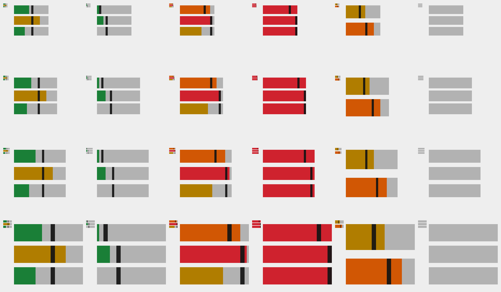
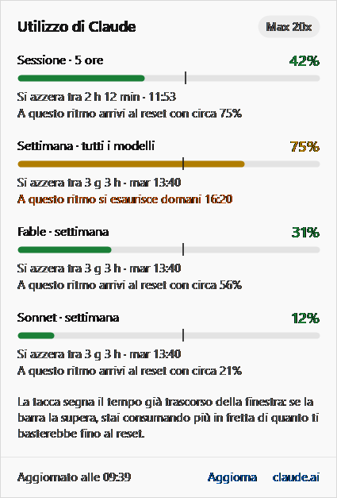

# TurboClaudeMonitor

Icona nella barra di Windows 11 che mostra a colpo d'occhio quanto hai usato dei limiti di Claude: la sessione di 5 ore, la settimana (tutti i modelli) e il limite settimanale di Fable.

## Come si legge l'icona

Tre barre orizzontali, dall'alto in basso:

1. **Sessione** (finestra di 5 ore)
2. **Settimana**, tutti i modelli
3. **Fable**, limite settimanale (se il tuo account non lo ha, le barre sono due)

Il riempimento è la percentuale usata. Il colore cambia con la soglia: **verde** sotto il 50%, **ambra** dal 50%, **arancio** dall'80%, **rosso** dal 95%. Una barra piena e rossa è un limite esaurito.

La **tacca** verticale segna quanto tempo della finestra è già trascorso. Se il colore va oltre la tacca stai consumando più in fretta di quanto ti basterebbe fino al reset; se resta prima, sei in margine. La tacca si spegne dal menu.

Barre **grigie** vogliono dire dati non aggiornati: login scaduto o assente, oppure nessuna risposta da troppo tempo.



## Dettagli

- **Passando il mouse** sull'icona: percentuale e orario di reset di ogni barra.
- **Clic** sull'icona: il pannello completo, con tutti i limiti (anche Sonnet o Opus se presenti), il conto alla rovescia del reset, la proiezione al ritmo attuale («a questo ritmo si esaurisce domani 16:20») e i link per aggiornare o aprire la pagina Utilizzo di claude.ai. Esc o un clic altrove lo chiude.
- **Clic destro**: aggiorna ora, frequenza di aggiornamento (3, 5, 10 o 15 minuti; 5 è il default), tacca sì/no, avvisi a 80%, 95% e 100%, rinnovo automatico del login, avvio con Windows, esci.



Windows 11 mette le icone nuove nel menu nascosto (la freccia ^). `installa.cmd` la fissa da solo; a mano: Impostazioni › Personalizzazione › Barra delle applicazioni › Altre icone della barra, e attiva TurboClaudeMonitor.

## Da dove prende i dati

Interroga, in sola lettura, lo stesso indirizzo che usa il comando `/usage` di Claude Code (`https://api.anthropic.com/api/oauth/usage`), con il login che Claude Code salva in `%USERPROFILE%\.claude\.credentials.json` (o nella cartella indicata da `CLAUDE_CONFIG_DIR`).

Serve quindi **Claude Code da terminale con un login attivo**. L'app desktop di Claude non scrive quel file: il suo login è cifrato e l'app non lo legge. La CLI non interferisce con l'app desktop: è un programma separato con un login separato dello stesso account.

### Installazione in un passo

Doppio clic su **`installa.cmd`**. Lo script:

1. compila il monitor, se manca o se i sorgenti sono cambiati;
2. installa Claude Code da terminale con l'installer ufficiale (`https://claude.ai/install.ps1`), dopo averti chiesto conferma, e aggiunge `%USERPROFILE%\.local\bin` al PATH;
3. avvia `claude auth login --claudeai`: si apre il browser, accedi con il tuo account e autorizzi; il login lo fai tu, lo script aspetta;
4. fa una prima lettura dei limiti e te la mostra;
5. avvia il monitor, ti chiede se farlo partire con Windows e fissa l'icona nella barra, fuori dal menu nascosto.

Si può rilanciare quando vuoi: salta i passi già fatti. Con `installa.cmd -Relogin` rifà il login; con `-NoAutostart` non chiede dell'avvio con Windows.

A mano, lo stesso si ottiene con `irm https://claude.ai/install.ps1 | iex`, poi `claude auth login`, poi l'avvio di `bin\TurboClaudeMonitor.exe`.

### Rinnovo automatico del login

Il login di Claude Code scade dopo alcune ore. Con «Rinnova il login da solo» (attivo di default, si spegne dal menu) l'app lo rinnova quando è scaduto o quando il server lo rifiuta, con lo stesso meccanismo OAuth di Claude Code. Poi riscrive i nuovi token nel file di Claude Code, così anche Claude Code continua a funzionare.

- Rinnova solo a login già scaduto: se Claude Code è in uso, lo rinnova lui qualche minuto prima e l'app trova il file già aggiornato.
- Prima di scrivere rilegge il file: se nel frattempo Claude Code ha rinnovato per conto suo, vince la versione di Claude Code. La scrittura passa da un file temporaneo e non tocca gli altri campi.
- Se i due rinnovano proprio nello stesso istante, uno dei due può trovarsi un token non più valido: in quel caso basta rifare `/login` in Claude Code. Se il server rifiuta il rinnovo, l'app non riprova con lo stesso token e lo dice nel pannello.
- Indirizzo e identificativo del client OAuth sono quelli pubblici di Claude Code: prova prima `https://platform.claude.com/v1/oauth/token`, poi `https://console.anthropic.com/v1/oauth/token`. Se Anthropic li cambia, si sovrascrivono con le variabili d'ambiente `TURBOCLAUDE_TOKEN_URL` e `TURBOCLAUDE_CLIENT_ID` (c'è anche `TURBOCLAUDE_USAGE_URL` per l'indirizzo dei limiti).

Con il rinnovo spento l'app legge il file e basta: a login scaduto l'icona resta grigia finché non usi Claude Code dal terminale.

### Altro

- L'indirizzo dei limiti non è documentato da Anthropic: può cambiare senza preavviso. Per questo l'aggiornamento è ogni 5 minuti e non più spesso; se il server chiede di rallentare, l'app aspetta almeno 10 minuti.
- Nessun dato esce dal PC se non verso i server di Anthropic. I token restano solo nel file di Claude Code: mai nei log né nella cache dell'app.

## Compilare

Non serve installare niente: usa il compilatore C# già presente in Windows (.NET Framework 4.8).

```powershell
.\build.ps1
```

Crea `bin\TurboClaudeMonitor.exe`, un solo file che puoi spostare dove vuoi (se lo sposti, riattiva «Avvia con Windows» dal menu).

Opzioni da riga di comando:

| Opzione | Cosa fa |
| --- | --- |
| `--demo` | Avvia l'icona con numeri finti, senza rete né login |
| `--check file.txt` | Una lettura dei limiti (con rinnovo del login se serve), riassunta in un file di testo senza token: utile se l'icona resta grigia |
| `--render cartella` | Salva immagini ingrandite dell'icona e del pannello |

## File

- Impostazioni: `HKCU\Software\TurboClaudeMonitor`; avvio automatico in `HKCU\...\CurrentVersion\Run`.
- Ultima risposta e log: `%LOCALAPPDATA%\TurboClaudeMonitor\` (`last-usage.json`, `monitor.log`).
